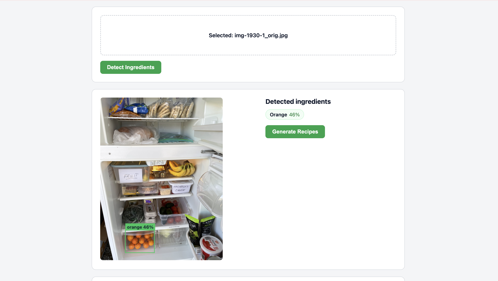
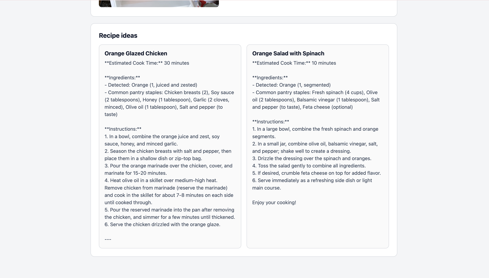

# PantryChef

Upload a photo of your fridge or countertop. The app detects food items using
Roboflow's hosted inference API, then passes the detected ingredients to
GPT-4o-mini to suggest recipes -- bounding boxes on the image, ingredient
chips with confidence scores, and recipe cards, all on one page.

Built as a first-time computer vision project to explore Roboflow's inference
stack and understand where Universe models succeed and fail in real-world
conditions.

---

## Demo

**Detection + bounding box**



**Recipe output**



---

## Stack

- **Frontend:** React (Vite), single page
- **Backend:** Node.js + Express
- **Detection:** Roboflow hosted inference API (REST, base64 POST)
- **Recipes:** OpenAI GPT-4o-mini via chat completions
- **Canvas overlay:** bounding boxes drawn client-side using HTML5 Canvas

---

## Setup

### 1. Backend

```bash
cd server
npm install
```

Copy `.env.example` to `.env` and add your keys:

```
ROBOFLOW_API_KEY=your_roboflow_key_here
OPENAI_API_KEY=your_openai_key_here
PORT=3001
```

Start the server:

```bash
node index.js
```

Backend runs on `http://localhost:3001`.

### 2. Frontend

In a separate terminal:

```bash
cd client
npm install
npm run dev
```

Frontend runs on `http://localhost:5173`. Vite proxies `/api/*` to the
backend (configured in `vite.config.js`).

---

## Usage

1. Open `http://localhost:5173`
2. Upload a fridge or countertop photo
3. Click **Detect Ingredients** -- Roboflow runs inference, bounding boxes
   appear on the image, detected items show as chips with confidence scores
4. Click **Generate Recipes** -- GPT-4o-mini generates 2-3 recipes from
   the detected ingredients

---

## Model Evaluation

Finding the right Universe model was a significant part of this project.
Two models were evaluated before reaching a conclusion about what's
actually available for this use case.

### Model 1: `deluxeviper/fridge-ingredients/2` -- rejected

- 37 classes listed, mAP@50 93.3%, 2,420 training images
- Every prediction on real fridge photos came back as "Apple" at 100%
  confidence regardless of what was actually in the image
- Root cause: the dataset is apple-dominated. The Universe Images tab shows
  almost exclusively apple photos. Of the 37 listed classes, 8 are apple
  variants: `Apple`, `apple`, `Blotch_Apple`, `damaged_apple`,
  `Normal_Apple`, `red apple`, `green apple`, `Orange`
- This is a freshness grader, not a fridge ingredient detector. The name
  is misleading. The 93.3% mAP measures apple classification performance,
  not general ingredient detection
- Lesson: aggregate mAP without per-class breakdown tells you very little
  about a multi-class model's real-world usefulness

### Model 2: `james-elcock/fridge-detection-ojugs/6` -- current

- 77 classes, mAP@50 82.9%, 3,268 images, 6 dataset versions
- Genuine multi-class coverage: apple, orange, banana, tomato, carrot,
  broccoli, chicken, egg, milk, bread, cheese, avocado, butter, salmon,
  lettuce, and more
- Version 6 selected (most recent, trained 2023-09-09). Version 2 had
  99.5% mAP -- a red flag for overfitting, not generalisation
- Confidence threshold set at 0.35 after testing. The default 0.5 was
  filtering out valid detections on real-world images

---

## Real-World Testing Findings

Four test cases run against the live model with real photos:

| Test | Image | Result | Assessment |
|------|-------|--------|------------|
| 1 | Real fridge, cluttered, mixed contents | Orange detected at 46%, bounding box correctly placed over clementines. Bananas, eggs, greens, tomatoes missed. | Partial detection. Most items were in containers or bags -- model not trained on packaged items |
| 2 | Clean countertop, visible apple + cheese + nuts | Zero detections | False negative. Items are in the model's class list, clearly visible, unobstructed. Generalisation failure |
| 3 | Freezer packed with zip-lock bags | Milk detected at 54% | False positive. No milk present -- model identified a white rounded shape through a bag |
| 4 | Fridge containing only beverages and packaged goods | No detections | Correct. Nothing in the 77 classes was present |

**Summary:** The model works on images close to its training distribution.
Real-world fridge photos with packaging, occlusion, varied lighting, and
diverse layouts sit outside that distribution more often than not. Looking
at the Universe training images confirms this -- the dataset is composed
of dark, low-resolution fridge photos that do not represent the range of
inputs a real app would receive.

The pipeline architecture is correct. The limiting factor is training data
quality and coverage, not the integration.

---

## Implementation Notes

**Bounding box scaling:** Roboflow returns coordinates relative to the
original image dimensions. The canvas overlay scales these to match the
displayed image size using `naturalWidth / clientWidth` ratio -- otherwise
boxes render in the wrong position when CSS resizes the image.

**Recipe card splitting:** GPT's markdown output format varies between
runs. Splitting on "estimated cook time" (a phrase the system prompt
requires exactly once per recipe) is more reliable than splitting on
generic markdown patterns like `###` or numbered lines, which also match
ingredient lists and instruction steps.

**Multer:** Upgraded to 2.x -- 1.x has known CVEs. API is identical
(`memoryStorage()`, `.single()`, `limits`).

**Deduplication:** Predictions are grouped by class before rendering chips
and before sending to the recipe API. The chip display and the API payload
share a single `visibleIngredients` derived value -- they cannot disagree.

---

## What's Next

The case for a better model is clear from the testing results. In order
of impact:

**Fine-tune on real data.** Collect 500-1000 real fridge photos with
diverse contents, varied lighting, and items both inside and outside
packaging. Annotate using Roboflow Annotate. The current Universe models
were not built for the messiness of actual fridge contents.

**GPT-4o Vision fallback.** When Roboflow returns zero detections or
collapses to a single class, re-run using GPT-4o Vision. Vision-language
models handle packaging labels, context clues, and partial occlusion
better than a detection model trained on a narrow distribution.

**Per-class confidence thresholds.** A single global threshold is a blunt
instrument. Some classes (whole banana, whole apple) are easy to detect
at high confidence. Others (eggs inside a carton, cheese in a wrapper)
are harder. Per-class calibration would reduce both false positives and
missed detections.

---

## Notes

- API keys stay on the backend (`server/.env`, gitignored) and are never
  exposed to the browser
- Local development only -- no auth, no persistence, no deployment config
- The previously evaluated model (`deluxeviper/fridge-ingredients/2`) is
  kept as commented-out code in `server/index.js` with a note explaining
  why it was replaced